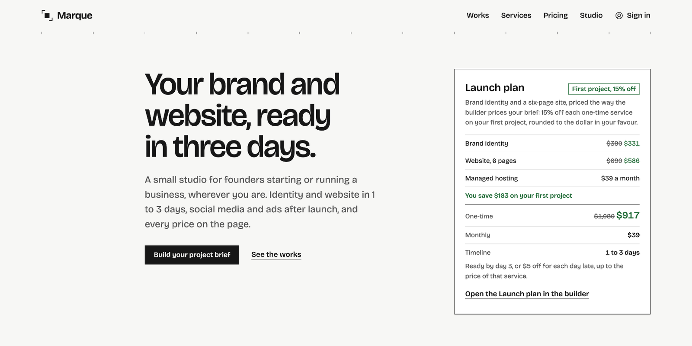
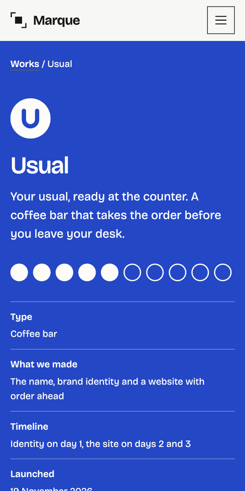

# Marque

Marque is a small brand and website studio for founders starting or running a business, wherever they are. It designs
identities, builds websites, hosts them if you like, and runs social media and ads. This is its website: every service
with its price, a project builder that adds those prices up into a brief, the three projects it made, and a sign-in
where saved briefs wait.

  
  

## Pages

- **Home** (`/marque/`): the headline beside a receipt for the Launch plan (identity and a six-page website: $1,080,
  $917 as a first project, ready in 1 to 3 days, then $39 a month if the studio hosts it), the three projects with
  studio figures, what Managed hosting includes, what you can count on, services with their regular and
  first-project prices, how a project runs with two founder quotes, monthly work after launch, and a closing call.
- **Works** (`/marque/works/`): the three projects, sortable by newest, oldest or name (a radio group that announces the
  new order; without JavaScript the list stays newest first). Each card has the project's thumbnail, mark, type, what
  Marque made and the launch date.
- **Usual**, **Bayline** and **Enamel** (`/marque/works/usual/` and so on): one page each, led by the project's own
  colour and mark: the brief, what the studio did and made, the timeline, desktop and phone screens, a link to the live
  site, and the previous and next project. All three are Marque's own studio projects, and say so.
- **Services** (`/marque/services/`): the six services with their price, first-project price, time and the late-day
  credit, what's included and what isn't (for the website, Managed hosting or a handover of the code), how the prices
  work, and the FAQ.
- **Pricing** (`/marque/pricing/`): three plans built from real mixes (Launch, highlighted; Website; Grow), each opening
  the builder pre-filled; a table of every service with its regular price, first-project price and timeline; Managed
  beside Handed over; the first-project rule and the late-day credit, stated once; two founder quotes; billing
  questions.
- **Studio** (`/marque/studio/`): who the studio is, what it holds to, the five steps of a project with the
  days they take, where and when, and what the studio doesn't do. The footer's "Studio".
- **Start a project** (`/marque/start/`): the project builder and the contact form. The menu's "Start a project" and
  the footer's "Contact".
- **Sign in** (`/marque/account/`): email and a one-time code first, Continue with Google as the alternative, with
  Create account a link away (`#create`); signed in, it lists the saved briefs as receipts.
- **Terms of Service**, **Privacy Policy**, **Cookie Policy** and **Accessibility**, linked from the footer, and a 404.
  The old `/marque/work/` address redirects to Works (and `/work/#usual` to Usual's page).

The header links Works, Services, Pricing, Studio and Sign in; on phones an icon button opens the menu sheet, which also
holds "Start a project".

## What you can do

- Price a project: tick services, set pages, platforms, posts, shoots and print pieces, choose whether the website is
  managed or handed over, and watch the one-time total, the monthly total and the timeline change. Every one-time
  service is ready in 1 to 3 days (a website's days start once the text and photos are in); if the studio delivers after
  day 3, $5 comes off for each day late, up to the price of that service. Brand identity is $390; a website $690 for up
  to six pages plus $60 a page after that, up to twelve. Managed hosting is $39 a month, which is where a website starts
  when ticked: a free Marque subdomain or the client's own domain, daily backups, uptime monitoring, security updates,
  SEO setup and up to an hour of edits a month, cancellable any time. Handed over has no monthly fee: the code and a
  deploy guide, with hosting left to the client. Domains are never sold. Social media is from $290 a month (one
  platform, which is where it starts when ticked; two are $390); ads $250 a month plus ad spend paid to the platforms; a
  half-day shoot with a booked local photographer $290; a print piece $90.
- Keep "My first project with Marque" ticked (it starts ticked) for 15% off the one-time work. Every one-time price
  shows the regular price struck through beside the first-project one, in green: on Home, Services, Pricing, the
  builder's rows and receipt, the phone bar, saved briefs and the brief text, with one savings figure ("You save $163 on
  your first project"). Each one-time service takes 15% off, rounded to the dollar in the client's favour, so a service
  has one first-project price alone or in any mix (identity $331, a website $586, each extra page $51). Monthly work is
  never discounted, and unticking shows regular prices everywhere. Briefs saved before the discount existed open without
  it.
- Press "Use this brief" to drop the priced brief into the contact form's message. The form checks each field, then says
  plainly that sending isn't connected yet, keeps what you typed, and points to "Save brief".
- Press "Save brief" to keep it on this device (pressing it again for the same brief says it's already saved, and at
  twelve briefs the oldest makes room), then sign in. Signing in with email shows the four-digit code on the page,
  labelled as a preview until emails are sent; Create account also asks for a first name. Continue with Google says it
  isn't connected yet. There is no password. Signing in from another page (`?next=`, same site only) returns you there.
  Your briefs list each saved brief as a receipt; open one back in the builder or remove it.
- Follow a plan on Pricing, the receipt on Home or "Add to a brief" on any service to open the builder pre-filled.
- Sort the works and open each project's page and its live site.

## What's real, and what isn't connected yet

Marque presents itself as a working studio. The builder, the contact form, the newsletter and the sign-in run in the
browser only, and each says so where it matters. There are no server accounts, analytics, cookies or payments yet, and
every page carries `noindex` until the backend is live.

The studio figures on Home and the founder quotes on Home and Pricing are placeholder content for the prototype, kept in
`app/lib/samples.ts`; see "Sample content" in [BACKEND.md](BACKEND.md).

The three projects on Works (Usual, Bayline and Enamel) are Marque's own studio projects: briefs the studio set itself,
made end to end, with no client results claimed.

## How the code is laid out

- `app/`: one folder per page (`app/pricing/index.html`, `app/works/usual/index.html`), the shared end of every head,
  the header and the footer in `app/components/`, the styles in `app/styles/`, and `app/boot.ts`, which starts every
  page's scripts.
- `app/lib/`: the rules: prices and estimates (`estimate.ts`), accounts (`account.ts`), contact checks, works, start
  links, formatting, counting (`count.ts`), dates (`time.ts`), and the placeholder figures and quotes. Only `backend/`
  touches the browser. `account.ts` takes the site's base path from `build/site.ts`, which has no Node-only code.
- `app/lib/backend/`: one small interface per backend concern (sign-in, briefs, contact, newsletter) in `types.ts`, the
  local adapters that keep today's behaviour (`storage.ts` wraps localStorage, and `local-auth.ts` and `local-briefs.ts`
  hold its two keys, `marque.account` and `marque.briefs`; they are the only code that touches localStorage apart from
  the header's first-paint script, which [BACKEND.md](BACKEND.md) documents), and `index.ts`, the one place the pages
  get their backend. [BACKEND.md](BACKEND.md) maps each interface to the endpoint that will replace its local adapter.
- `app/start/`, `app/account/`, `app/works/`: the page scripts, which talk only to the backend object.
- `app/shared/`: helpers every page uses (menu, button fill, reveal, form fields, newsletter).
- `build/`: putting pages together (the partials, and the figures and quotes), the base path, and checking the site
  address.
- `tests/` and the `*.test.ts` files beside the code: the logic, the adapters, every page, and the pages driven in
  jsdom.

## Design

Marque's design system, "Margin", uses paper, ink and graphite, with one deep green kept for first-project prices
and savings, so the screenshots of the work bring the rest of the colour; Bricolage Grotesque as the only family; a
visible 12-column grid with section numbers in the margin; square corners and fine rules; short, precise motion, such
as the button fill that spreads like the logo's square from where the pointer comes in and swaps the button's two
colours. It was shaped by studying how other studios set prices and type.

## License

The code is released under the [MIT License](LICENSE). Bricolage Grotesque is under the SIL Open Font License 1.1;
Phosphor icons and Tailwind CSS are MIT. The screenshots are of the studio's own sites.

Running it locally or changing it? See [DEVELOPMENT.md](DEVELOPMENT.md).
