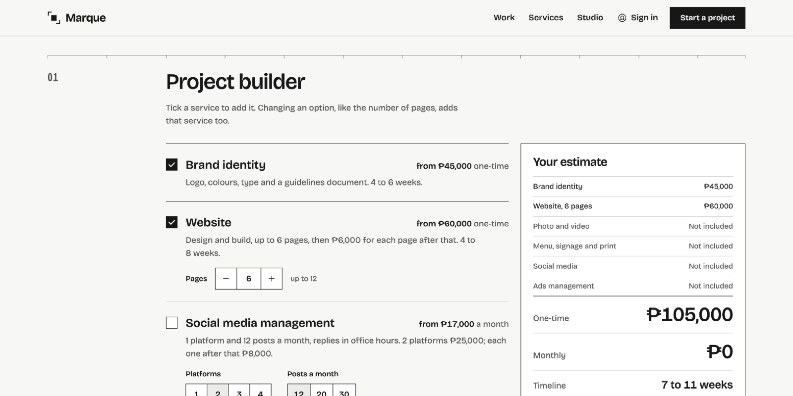
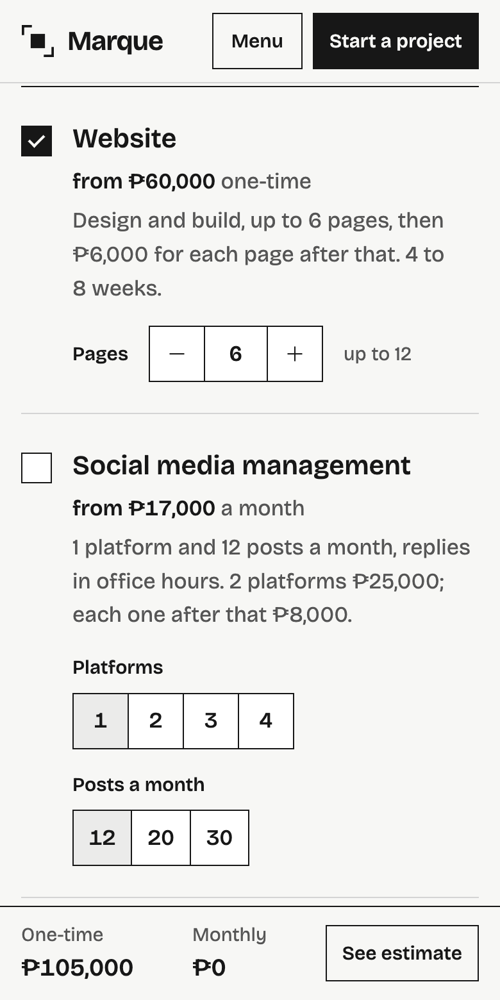

# Marque

Marque is a concept brand and marketing studio in Mabolo, Cebu City. It designs identities, builds websites and runs
social media and ads for cafés, clinics, shops and service businesses in Cebu. This is its website: every service with
the price it starts from, a project builder that adds those prices up into a brief, the three projects it made, and a
client sign-in where saved briefs wait.

  
  

## Pages

- **Home** (`/marque/`): the studio in one line, the three projects, the launch set (identity and a six-page website,
  ₱105,000, 7 to 11 weeks), what you can count on, services and starting prices, how a project runs, monthly work after
  launch, and a closing call to start a project.
- **Work** (`/marque/work/`): the three case studies, Usual (coffee bar), Bayline (car wash) and Enamel (dental clinic):
  the brief, what the studio did, what it made, desktop and phone screenshots, and a link to each live site. All three
  are labelled concept projects.
- **Services** (`/marque/services/`): the six services with their starting price, time, what's included and what isn't,
  how the prices work, and the FAQ.
- **Studio** (`/marque/studio/`): who works there (by role), what they hold to, the five steps of a project with the
  weeks they take, where and when, and what the studio doesn't do. The footer's "About".
- **Start a project** (`/marque/start/`): the project builder and the contact form. The footer's "Contact".
- **Your briefs** (`/marque/account/`): the client sign-in and the briefs saved from the builder; Sign out sits under the greeting.
- **Terms of Service**, **Privacy Policy**, **Cookie Policy** and **Accessibility**, linked from the footer, and a 404.

## What you can do

- Price a project: tick services, set pages, platforms, posts, shoots and print pieces, and watch the one-time total, the
  monthly total and the timeline change. Brand identity is ₱45,000; a website ₱60,000 for up to six pages plus ₱6,000 a
  page after that; social media from ₱17,000 a month (one platform, which is where it starts when ticked; two are ₱25,000); ads ₱15,000 a month; a shoot ₱18,000; a print piece ₱8,000.
- Press "Use this brief" to drop the priced brief into the contact form's message, then send it. The form checks each
  field and says plainly that nothing was sent or saved, and points to "Save brief" and Your briefs. A brief with no
  one-time work leaves the one-time total out of its text.
- Press "Save brief" to keep it on this device (pressing it again for the same brief says it's already saved, and at
  twelve briefs the oldest makes room), then sign in with your first name and an email or Philippine mobile number
  (09…, +63 9… or just the ten digits from 9). A four-digit code is printed on the page; there is no password. Your
  briefs list each saved brief with its lines, totals and timeline; open one back in the builder or remove it.
- Follow "Price the launch set" on Home or "Add to a brief" on any service to open the builder with those services
  already picked.
- Open the three case studies and their live sites.

## What's real

Marque is a concept brand, and this is a demonstration site. The site names no author, because it is built as the real
product would be; this README may. The footer's "About this site" opens a note (without JavaScript it links to the same
text on the Terms page) that says "Marque is a concept brand.
This is a demonstration site: nothing you enter here is sent, and no payments are taken.", and the Terms page repeats
it. The builder, the contact form, the newsletter and the sign-in all stay in your browser: the sign-in and the saved
briefs live in localStorage (`marque.account`, `marque.briefs`), behind try/catch, so the site works with storage blocked.
There are no accounts, analytics, cookies or payments. Every page carries `noindex`.

The three projects on the Work page, Usual, Bayline and Enamel, are concept sites too, designed and built as part of
the same set. The studio's prices and process are the concept business's own.

## Design

Marque's design system, "Margin", uses paper, ink and graphite with no accent colour,
so the screenshots of the work bring the only colour; Bricolage Grotesque as the only family; a visible 12-column grid
with section numbers in the margin; square corners and fine rules; short, precise motion. It was shaped by reading the
published design notes of Vercel, Apple, Stripe and Framer.

## License

The code is released under the [MIT License](LICENSE). Bricolage Grotesque is under the SIL Open Font License 1.1;
Phosphor icons and Tailwind CSS are MIT. The screenshots are of the author's own concept sites.

Running it locally or changing it? See [DEVELOPMENT.md](DEVELOPMENT.md).
